<div align="center">

# 🦥 SnapSloth

**For every screenshot you said "baad mai" to.**

Sorts, searches and safety-checks your screenshots with a local AI model, while you sleep.

[](https://go.dev)
[](https://ollama.com)
[](#privacy)
[](LICENSE)

[Setup](#setup-one-command) · [Using the app](#using-the-app) · [Lazy mode](#lazy-mode-every-night-at-2-am-) · [Privacy](#privacy)

</div>

## 😩 The problem

You take a screenshot because you'll deal with it "baad mai". A fee notice, a UPI payment, a train
ticket, an error to fix, a note to yourself. Two months later there are 367 of them, all named
`Screenshot from 2026-08-30 23-51-07.png`, and:

- **You can't find anything.** Your file manager searches names, and every name is a timestamp.
- **You forget what mattered.** The railway concession, the money request, the hostel fee deadline:
  buried under memes.
- **Some of them are a risk.** OTPs, UPI IDs, Aadhaar and bank details, sitting in a folder that syncs
  and gets shared.
- **Cloud AI isn't the fix.** Uploading your Aadhaar to someone's server to organise it is worse.

## 🦥 The solution

SnapSloth reads every screenshot with a **local AI model** (Gemma 4 through Ollama) while you sleep, then:

- 🗂️ **renames and sorts** them into folders (`sorted/college_notice/2026-10-20_hostel-fee-due-notice.png`)
- 🔎 makes them **searchable by what's inside them**, text and picture
- ✅ pulls out **what you still have to do**: "→ Take concession for railway tomorrow"
- ⚠️ **flags risky ones** (OTPs, bank/UPI details, Aadhaar/PAN, passwords), with values masked
- ☕ gives you a **morning report**, with the things you saved and forgot

**Nothing leaves your laptop.** No cloud, no account, works with Wi-Fi off.

## ⏱️ Time saved

| | by hand | with SnapSloth |
|---|---|---|
| Sort and rename 367 screenshots | ~1.5 hours of opening, naming, moving | **0 minutes**: it runs overnight |
| Find "that one screenshot" | a couple of minutes of scrolling, each time | **seconds**: type a word |
| Check for OTPs, Aadhaar, bank details | open all 367 and look | **automatic**, every night |
| Remember what you still have to do | you don't 😅 | **listed every morning** |
| Every day after that | a few minutes, if you bother | **0 minutes** (~10 new screenshots ≈ 13 min, while you sleep) |

*By-hand times are rough estimates (~15 s per screenshot to open, name and file it).*

## Demo

🎥 **[Watch the demo video](https://drive.google.com/file/d/1CJxGJh5Il-MWysdkDQXCpUQOvMOhRJoM/view?usp=sharing)**

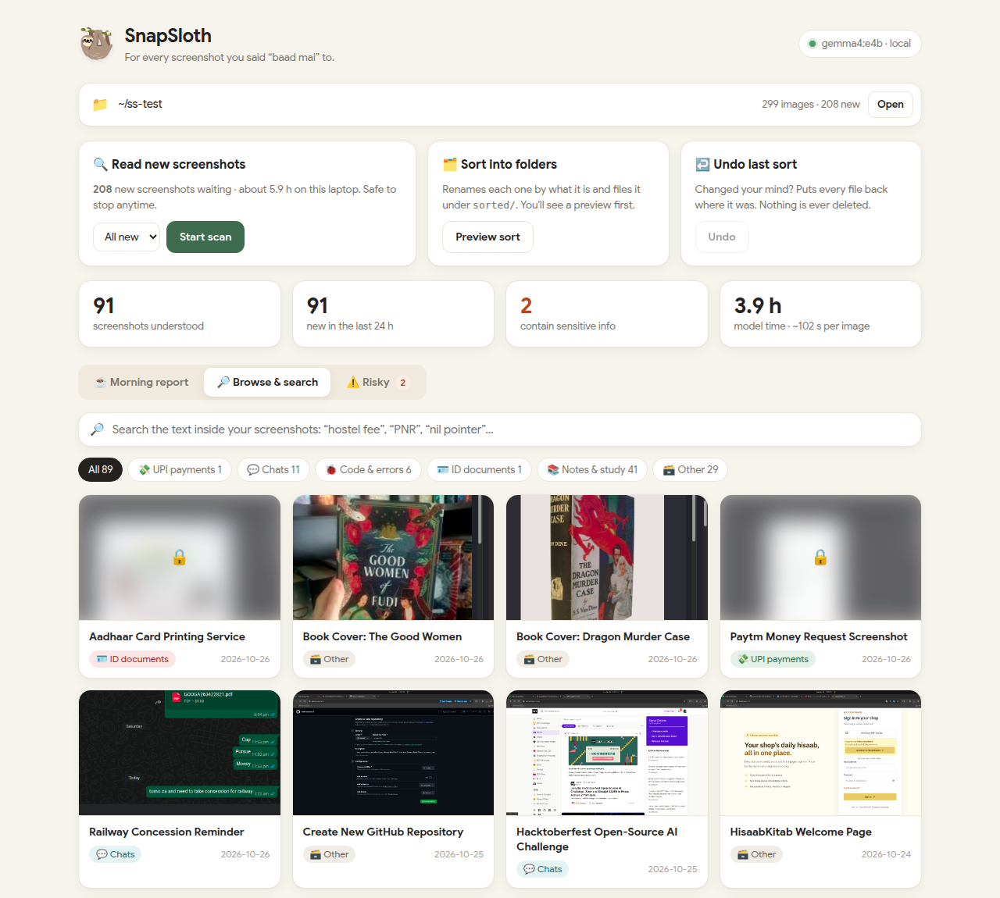

## Setup: one command

It installs Ollama (the local model runner) if you don't have it, downloads the model (~5.5 GB,
once), and installs SnapSloth.

**Linux / macOS** (Terminal):

```bash
curl -fsSL https://raw.githubusercontent.com/vimla01/snapsloth/main/install.sh | sh
```

**Windows** (PowerShell):

```powershell
irm https://raw.githubusercontent.com/vimla01/snapsloth/main/install.ps1 | iex
```

Then start the app:

```bash
snapsloth ui
```

Want the smaller, faster model? Set `SNAPSLOTH_MODEL=gemma4:e2b` before the install command
(`$env:SNAPSLOTH_MODEL="gemma4:e2b"` on Windows) and scan with `--model gemma4:e2b`.

<details>
<summary>Prefer to do it by hand?</summary>

1. Install Ollama from [ollama.com/download](https://ollama.com/download)
2. `ollama pull gemma4:e4b`
3. Download `snapsloth` for your system from [Releases](https://github.com/vimla01/snapsloth/releases),
   or with Go 1.27+: `go install github.com/vimla01/snapsloth@latest`
4. `snapsloth ui`

</details>

`snapsloth ui` opens the app in your browser. Pick your screenshots folder, press **Start scan**,
then **Sort**. That's it. (Try it on a copy first: `cp -r ~/Pictures/Screenshots ~/ss-test`.)

The app only listens on `127.0.0.1`, so no other device can reach it.

## Using the app

*Real screenshots from my own folder, scanned on my laptop.*

**1. Pick your folder and press Start scan.** Each screenshot gets read by the local model; you
can watch them come in, or walk away. Stop anytime: progress is saved and the next scan carries on.

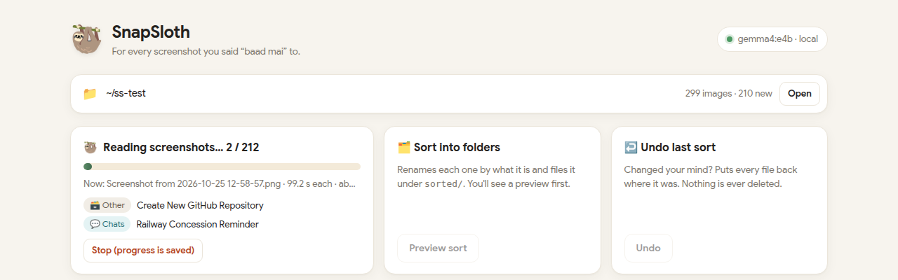

**2. Read your morning report.** What's in the folder, and the things you saved and probably forgot.

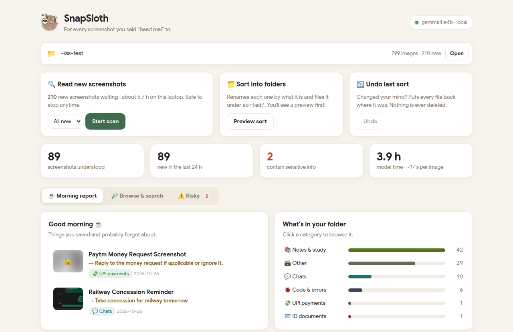

It reads the to-do out of the screenshot itself. My 1 AM WhatsApp note to myself, "tomo ca and
need to take concession for railway", came back the next morning as **→ Take concession for
railway tomorrow**.

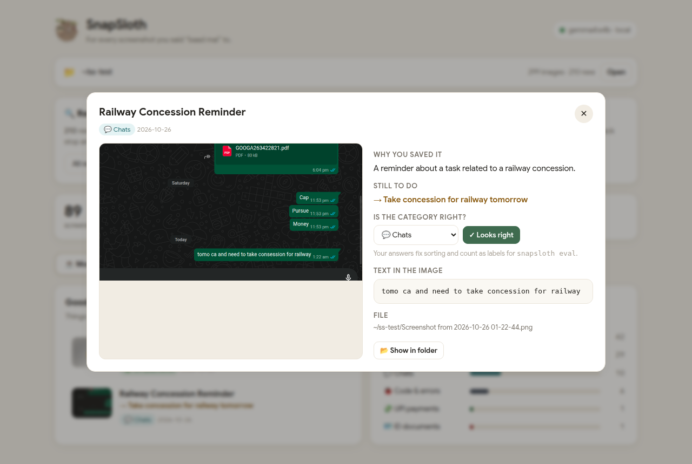

**3. Browse everything, by category.** Each screenshot gets a real title instead of a timestamp.
Risky ones stay blurred.


**Search by what's *inside* the screenshot.** Type "figma", "fee", "PNR", "nil pointer"... Click any result
to see what the model read and why you probably saved it.

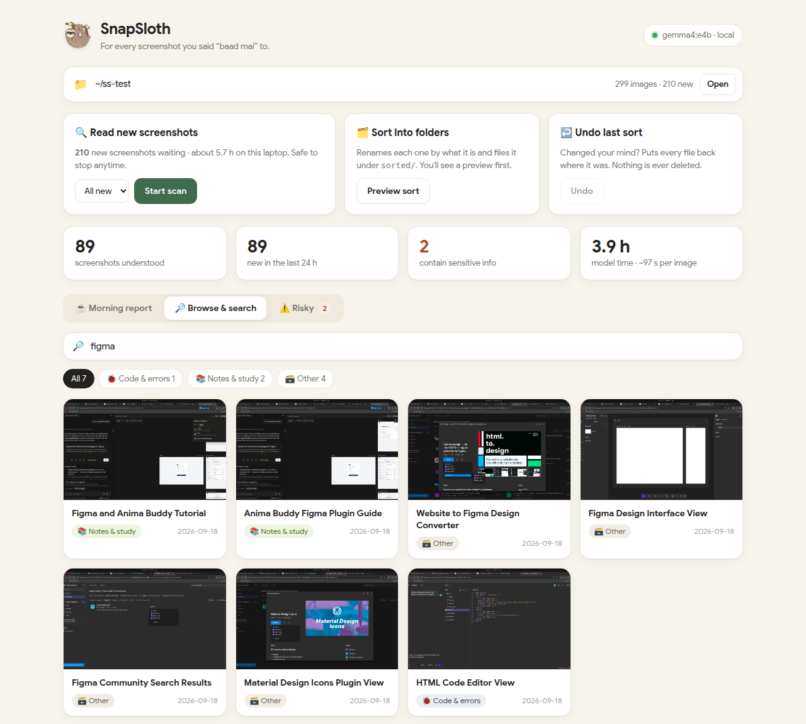

It understands what's in the picture, not just the text: searching "video call" finds the Meet calls.

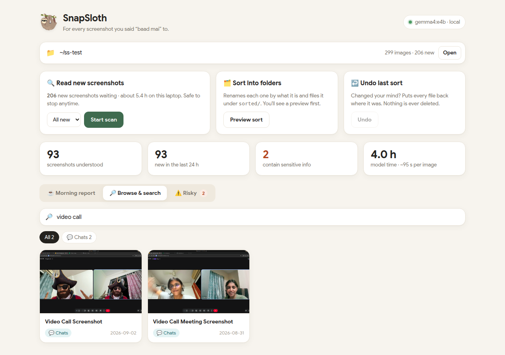

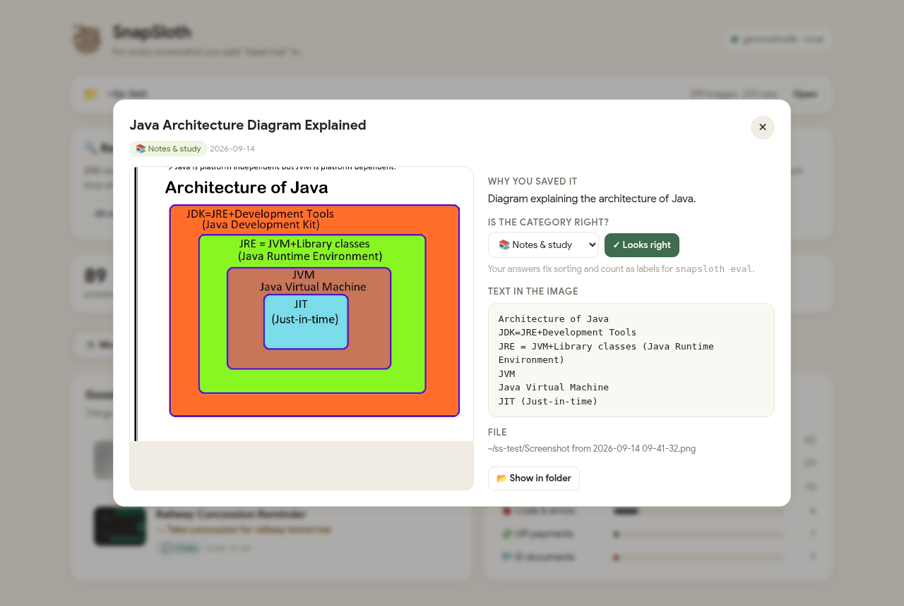

**4. Check the Risky tab.** Any OTPs, bank details, ID numbers or passwords show up here, masked and
blurred until you click. SnapSloth never deletes; *Show in folder* lets you clean up yourself.

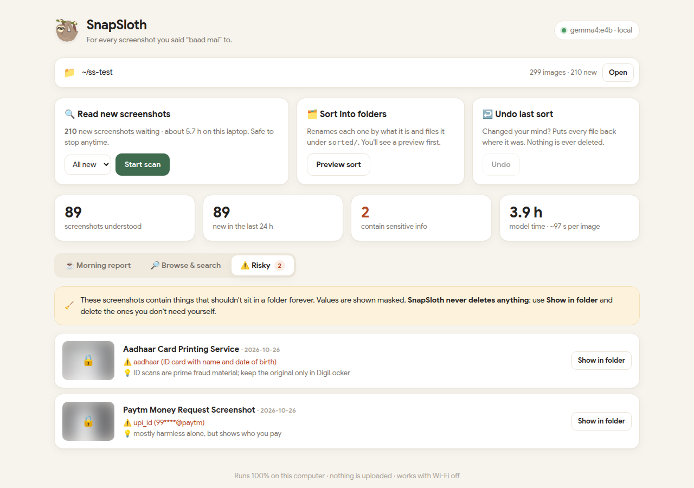

**5. You're in control.** In a screenshot's details, press *Looks right* or pick another
category. Sorting uses your answer, and `snapsloth eval ~/your-folder` turns your checks into an
accuracy score.

**6. Sort.** You see every rename before anything moves, and *Undo* puts it all back.

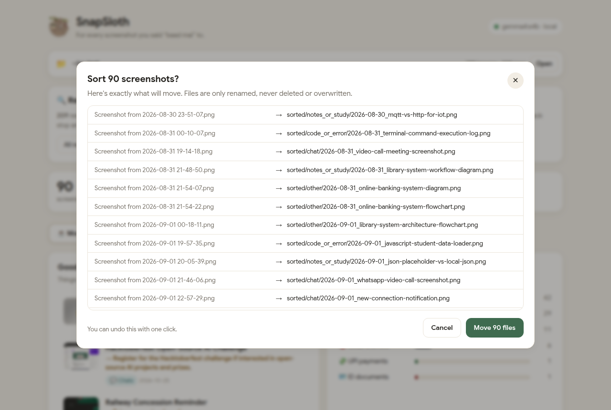

**Before**: one folder, every file named by the time it was taken.

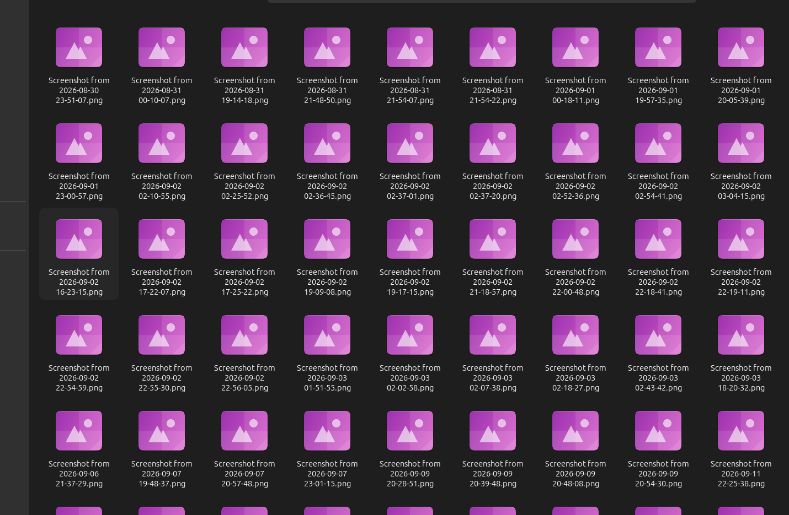

**After**: one folder per kind, every file named by what's inside.

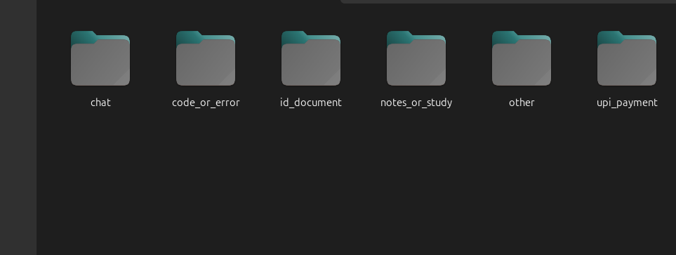

What's inside them (real result from my folder):

```
~/Pictures/Screenshots/
└── sorted/
    ├── notes_or_study/        43 files
    │   ├── 2026-08-30_mqtt-vs-http-for-iot.png
    │   ├── 2026-09-02_restful-apis-principles-explained.png
    │   └── 2026-09-14_java-architecture-diagram-explained.png
    ├── other/                 33 files
    │   ├── 2026-09-07_devfest-location-map-view.png
    │   └── 2026-10-26_book-cover-the-good-women.png
    ├── chat/                  12 files
    │   ├── 2026-08-31_video-call-meeting-screenshot.png
    │   └── 2026-10-26_railway-concession-reminder.png
    ├── code_or_error/          8 files
    │   ├── 2026-08-31_terminal-command-execution-log.png
    │   └── 2026-09-18_html-code-editor-view.png
    ├── upi_payment/            1 file
    │   └── 2026-10-26_paytm-money-request-screenshot.png
    └── id_document/            1 file
        └── 2026-10-26_aadhaar-card-printing-service.png
```

Every name starts with the date, so each folder stays in time order. Name clashes get `-2`, `-3`,
nothing is ever overwritten, and every move is logged so *Undo* can put it all back.

## Lazy mode: every night at 2 AM 🌙

`crontab -e`, add this line:

```cron
0 2 * * * S=$HOME/.local/bin/snapsloth D=$HOME/Pictures/Screenshots; { $S scan $D && $S sort $D; } > $HOME/snapsloth-morning.txt 2>&1; $S report $D >> $HOME/snapsloth-morning.txt 2>&1
```

(Installed with `go install`? Use `S=$HOME/go/bin/snapsloth`. `which snapsloth` tells you.)

Morning: open `~/snapsloth-morning.txt` (or `snapsloth ui`) with your chai. If the scan couldn't
run (say Ollama was off), the reason is at the top of that file. The laptop has to be awake at 2 AM.

Phone screenshots? Sync them to your laptop with [Syncthing](https://syncthing.net/) (local, no cloud).

## Terminal commands

| command | what it does |
|---|---|
| `snapsloth ui [dir]` | the point-and-click app |
| `snapsloth scan <dir>` | read new screenshots (`--limit N`, `--model`, `--dry-run`) |
| `snapsloth sort <dir>` | rename and file into `sorted/<category>/` (`--dry-run` to preview) |
| `snapsloth undo <dir>` | put the last sort back |
| `snapsloth search <dir> "hostel fee"` | find by text, title or category |
| `snapsloth risky <dir>` | list sensitive screenshots and why |
| `snapsloth report <dir>` | morning summary |
| `snapsloth eval <dir>` | accuracy vs the categories you checked in the app (or pass a `labels.csv`) |

Scans are resumable: Ctrl+C anytime, and already-read screenshots are skipped next time.

## Results

Measured on my laptop: Intel i5-1334U, 16 GB RAM, **CPU only, no GPU**, `gemma4:e4b`:

| | |
|---|---|
| Speed | **~70–80 s per screenshot** |
| My 367-screenshot backlog | ~7–8 hours, i.e. **one night** |
| A normal night (~10 new) | ~13 minutes |
| Your time per night | 0 minutes |

Two tricks made it ~3× faster: screenshots are shrunk to 1024 px before the model sees them
(a full-HD screenshot is 932 image tokens; at 1024 px it's 264, with text still sharp), and the
instructions go in the system prompt so Ollama caches them instead of re-reading them for every image.

**Two model sizes.** `gemma4:e4b` is the default for the most accurate titles and to-dos.
Want it quicker? `snapsloth scan --model gemma4:e2b` is ~35% faster with the same categories
on my test screenshots.

Tip: close heavy apps before a big first run so the model has the RAM to itself.

**Do I have to leave my laptop on all night?** Only once, for the backlog, and not even that:
newest screenshots are read first, so the report is useful after a few minutes, and you can stop
anytime and carry on later. After that it's ~10 new screenshots a day: a few minutes, whenever
the laptop is on. Doing it by hand would cost *your* time; this costs none.

## Privacy

- 100% local: the only network call is to Ollama on your own machine.
- The model's answer is double-checked with regex (OTP, Aadhaar, PAN, UPI, card numbers, passwords),
  and every value is **masked** (`XXXX-XXXX-1234`) on screen *and* in the saved index.
- **Never deletes anything.** Sort only renames, undo puts it back, risky only suggests.
- Its data lives in `<your folder>/.snapsloth/`, never in this repo.

## License

MIT, see [LICENSE](LICENSE).

---

<div align="center">

Built for the [DEV Hacktoberfest Open-Source AI Challenge](https://dev.to/challenges), Week 3: *Slow and Steady* 🦥

Made by [vimla01](https://github.com/vimla01) · Powered by [Gemma 4](https://ai.google.dev/gemma) and [Ollama](https://ollama.com)

</div>
